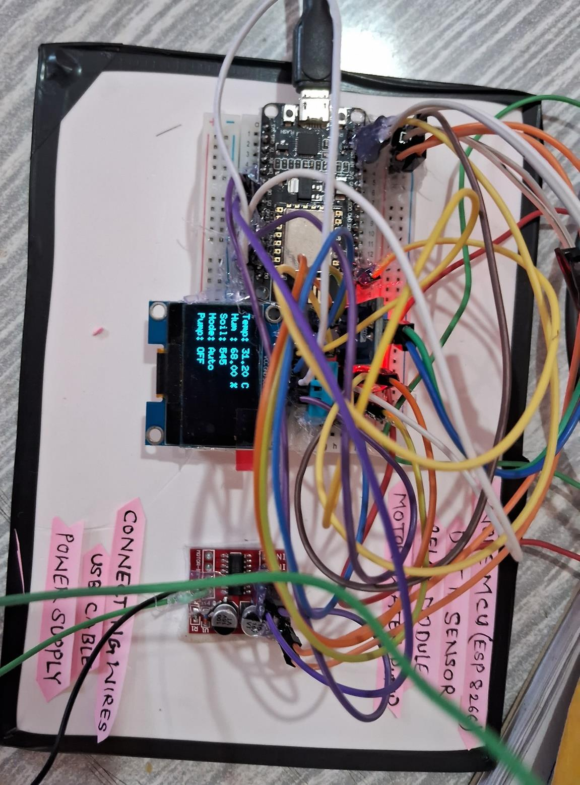
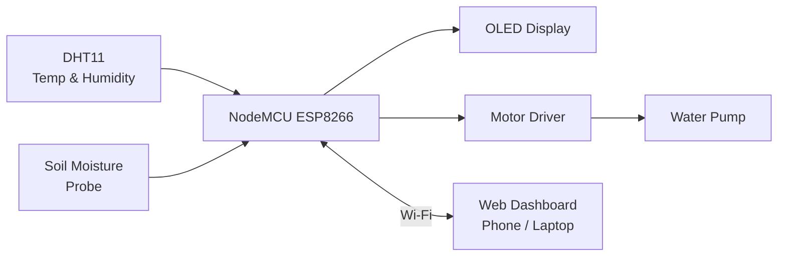
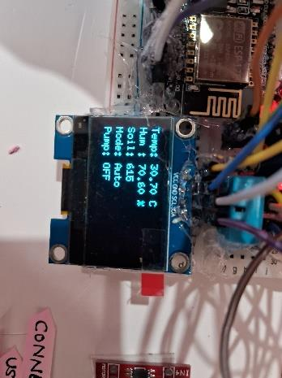
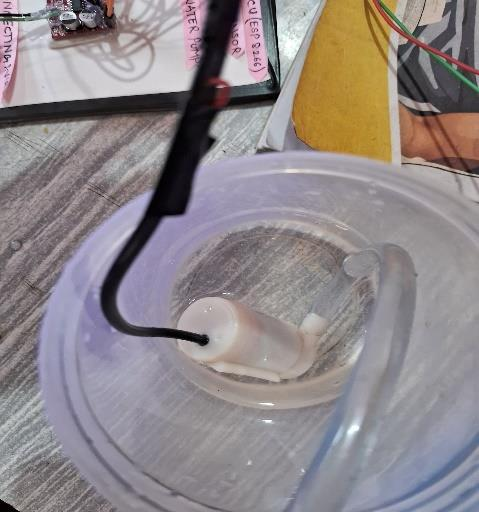
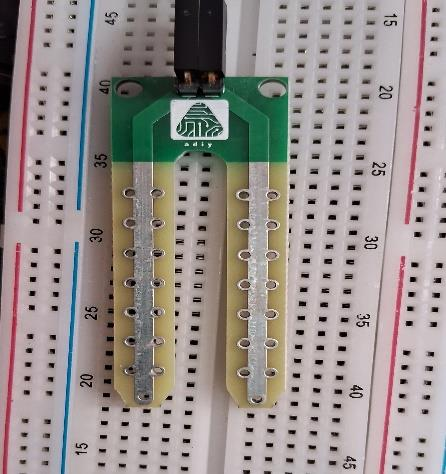
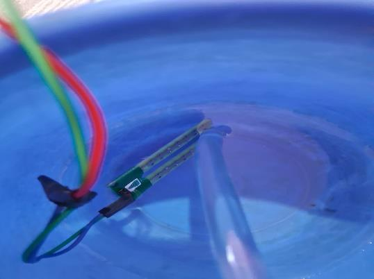
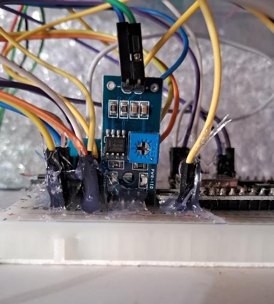
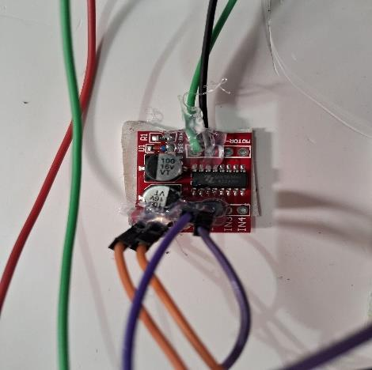

# 🌱 Smart Irrigation & Environment Monitor
### NodeMCU ESP8266 · DHT11 · Soil Moisture · OLED · Wi-Fi Dashboard

> A low-cost IoT system that **watches your plants' environment and waters them automatically**, with a manual override from any phone or laptop on the same Wi-Fi.

Final-year B.Tech (ECE) project, University College of Engineering and Technology, Vinoba Bhave University, 2025.



## ✨ What it does
| | |
|---|---|
| 🌡️ **Senses** | Temperature, humidity (DHT11) and soil moisture (analog probe) |
| 🧠 **Decides** | Auto mode starts the pump when soil is dry (`soilValue > 700`) |
| 💧 **Acts** | Drives a mini submersible pump via a motor driver module |
| 📟 **Shows** | Live readings and pump state on a 0.96" OLED |
| 📱 **Controls** | Built-in web dashboard: switch Auto/Manual and toggle the pump |

## 🧩 How it works


Every 2 seconds the firmware reads all sensors, applies the Auto/Manual logic, refreshes the OLED and serves any dashboard requests. The dashboard auto-refreshes every 5 seconds.

## 💻 Code walkthrough
Firmware is C++ (Arduino framework): [`code/smart_irrigation.ino`](code/smart_irrigation.ino)

**Main loop**: read, decide, display, serve.
```cpp
void loop() {
  readSensors();        // DHT11 + soil probe
  handleMotorLogic();   // Auto/Manual decision
  updateOLED();         // local status screen
  server.handleClient();// web dashboard requests
  delay(2000);
}
```

**Auto-irrigation logic**: a higher analog reading means drier soil.
```cpp
void handleMotorLogic() {
  if (autoMode) {
    motorStatus = (soilValue > 700);
  }
  motorStatus ? startPump() : stopPump();
}
```

**Pump control**: two driver inputs; both LOW means off.
```cpp
void startPump() { digitalWrite(IN1, HIGH); digitalWrite(IN2, LOW); }
void stopPump()  { digitalWrite(IN1, LOW);  digitalWrite(IN2, LOW); }
```

**Libraries used**: `ESP8266WiFi`, `ESP8266WebServer`, `DHT`, `U8g2`, `Wire`.

## 📸 Gallery
| | |
|---|---|
|  **Live readings on OLED** |  **Submersible pump** |
|  **Soil moisture probe** |  **Probe water test** |
|  **Soil sensor module** |  **Motor driver module** |

## 🔌 Hardware
Full list with roles and photos: [`HARDWARE.md`](HARDWARE.md)

| Component | Role |
|---|---|
| NodeMCU ESP8266 | Microcontroller + Wi-Fi |
| DHT11 | Temperature & humidity |
| Soil moisture probe + module | Soil dryness (analog) |
| Dual motor driver module | Switches the pump |
| Mini submersible pump | Irrigation |
| SH1106 OLED (I2C) | Local display |
| 5 V regulated supply | Power |

**Pin map**

| Signal | Pin |
|---|---|
| DHT11 data | D4 |
| Soil sensor analog out | A0 |
| Motor driver IN1 / IN2 | D5 / D6 |
| OLED SCL / SDA | D1 / D2 |

## 🚀 Quick start
1. Install the **ESP8266 board package** in Arduino IDE.
2. Install libraries: **DHT sensor library** (Adafruit) and **U8g2**.
3. Copy `code/secrets.h.example` → `secrets.h` and add your Wi-Fi details.
4. Board: **NodeMCU 1.0 (ESP-12E)** → Upload.
5. Open Serial Monitor (115200), note the IP, open it in a browser on the same network.

**Routes**

| Route | Action |
|---|---|
| `/` | Dashboard |
| `/mode?set=auto` / `manual` | Change mode |
| `/motor?set=on` / `off` | Pump control (manual mode only) |

Preview the UI without hardware: [`code/dashboard_preview.html`](code/dashboard_preview.html)

## 📊 Test results
- Readings logged every 30 s over one week
- Pump/relay response ≈ **2 s** after a command
- Data loss **< 1 %** during Wi-Fi fluctuations
- DHT11 accuracy ≈ ±2 °C, ±5 % RH (datasheet)
- Tested indoors and semi-outdoors

## ☁️ Cloud variant
The thesis also designs a REST/MySQL logging backend with remote relay commands. See [`code/CLOUD_API.md`](code/CLOUD_API.md).

## 🧗 Challenges & fixes
| Problem | Fix |
|---|---|
| Wi-Fi drops during power fluctuations | Auto-reconnect logic |
| Server timeouts delaying the relay | Raised timeout threshold |
| Hard to debug on the bench | Status LEDs + serial logs + OLED |
| DHT11 slow in rapidly changing air | Documented limitation; DHT22 planned |

## 🔭 Roadmap
- [ ] MQTT for faster messaging
- [ ] Mobile app
- [ ] DHT22 and capacitive soil sensor
- [ ] Multiple irrigation zones
- [ ] Dashboard authentication

## 📁 Structure
```
├── code/   # Arduino code (+ secrets.h.example)
├── software/                    # Dashboard preview
├── docs/                        # API / cloud design
└── images/                      # Project photos
```

## 👥 Team
Shambhavi Vaibhav · Rishabh Verma · Rajesh Mahto · Nikhil Kumar Mahato · Suman Kumar
Supervisor: **Amish Ranjan**, Assistant Professor, Dept. of ECE

## 📄 License
MIT
